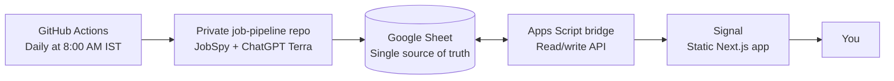

<div align="center">
  

  <p><strong>Less noise. More signal.</strong></p>

  <p>A personal job-search dashboard that finds the backend roles worth applying to, then gives you a clear next step for every one.</p>

  <p><a href="https://YOUR-USERNAME.github.io/signal">Open Signal</a> | <a href="#getting-started">Get started</a></p>
</div>

## Why Signal exists

Job hunting is mostly noise: too many portals, duplicate listings, vague role descriptions, broken links, and jobs that are a poor fit. Finding someone who can refer you - and writing a thoughtful message - can take longer than finding the role itself.

Signal turns that daily search into a short, focused queue.

> **Human-led. AI-assisted. Slightly over-caffeinated.**
>
> Signal is a collaboration between [Aditya](https://github.com/Aditya-Ramachandran) and ChatGPT Terra. Aditya owns the product direction, decisions, and final review; ChatGPT Terra brings an extra pair of tireless hands for writing, design exploration, implementation, job ranking, and referral-message drafting.

## What it does

- Searches LinkedIn, Indeed, Naukri, and Glassdoor for backend and software roles.
- Focuses on Bengaluru, Hyderabad, Pune, Mumbai, and India-remote opportunities.
- Filters by freshness, role fit, experience cap, and strict individual job URLs.
- Uses ChatGPT Terra to rank roles into **Tier A** (worth a referral hunt) and **Tier B** (apply-only).
- Drafts a job-specific referral message using the job ID and the candidate’s real stack.
- Deduplicates against the tracker, so the same job does not keep resurfacing.
- Tracks progress with one-click statuses: New, Applied, Referred, and Rejected.

## Product tour

| Area | Purpose |
| --- | --- |
| **Today** | Review fresh Tier A and Tier B roles in a focused card layout. |
| **Filters** | Move between all jobs, tiers, applied roles, and referrals. |
| **Referral message** | Copy a ready-to-edit, role-specific message in one click. |
| **Find contacts** | Open a prefilled LinkedIn people search for the company. |
| **Outreach** | Keep track of the every-two-day cold-email batch. |

## How it works



The pipeline runs in a separate private repository. It scrapes the portals, ranks the results, writes the day’s jobs to Google Sheets, and emails a backup report. Signal reads from the Apps Script bridge and writes status changes back to the same sheet.

## Tech stack

- Next.js App Router with static export
- TypeScript and Tailwind CSS
- Framer Motion for restrained, purposeful motion
- Google Apps Script and Google Sheets
- GitHub Actions and GitHub Pages
- Python, JobSpy, and the ChatGPT API for the pipeline

## Getting started

### Requirements

- Node.js 20 or newer
- A Google account
- A GitHub account
- An Apps Script web app connected to your tracker sheet

### Run locally

```bash
git clone https://github.com/YOUR-USERNAME/signal.git
cd signal
npm install
cp .env.example .env.local
```

Set the API endpoint in `.env.local`:

```env
NEXT_PUBLIC_API_URL=https://script.google.com/macros/s/YOUR-SCRIPT-ID/exec
```

Then start the development server:

```bash
npm run dev
```

On first load, Signal asks for your access key. The key is stored only in your browser's local storage; it is never committed to the repository or bundled into the app.

## Deploy to GitHub Pages

Pushing to `main` triggers the GitHub Actions workflow that builds the static export and publishes it to GitHub Pages.

Before the first deployment:

1. Enable GitHub Pages for the repository’s Actions workflow.
2. Add `NEXT_PUBLIC_API_URL` as a repository variable under **Settings → Secrets and variables → Actions → Variables**.
3. Update the repository name and `YOUR-USERNAME` placeholders in this README.
4. Push to `main` and check the Actions tab for the deployment.

## Privacy and safety

Signal does not send LinkedIn requests or emails automatically. You choose who to contact and send every message yourself, keeping your accounts safe and your outreach genuine.

The public repository contains no secrets. The Apps Script endpoint is not useful without the access key, which remains in the browser.

## Design principles

Signal is intentionally calm: a dark base, one clear accent, strong type hierarchy, and motion that helps you understand what changed. Every interaction supports the morning workflow, and animations respect `prefers-reduced-motion`.

## License

MIT © 2026 [Aditya Ramachandran](https://github.com/Aditya-Ramachandran)
