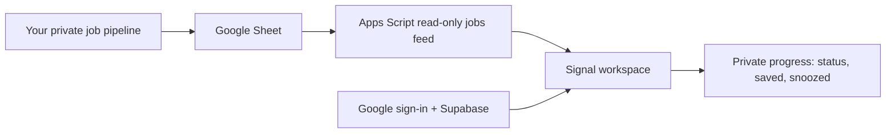

<h1 align="center">Signal</h1>

<p align="center">
  
</p>

<p align="center"><strong>Less noise. More signal.</strong></p>

<p align="center">
  A calmer first tab for your job search. Open it, make one good move, get on with your day.
</p>

<p align="center">
  <a href="https://aditya-ramachandran.github.io/Signal/">Try Signal</a> ·
  <a href="https://aditya-ramachandran.github.io/Signal/?demo=1">Explore the demo</a> ·
  <a href="https://aditya-ramachandran.github.io/Signal/guide">Set up your own</a>
</p>

Signal is a private, morning-first job-search workspace. It turns a personal jobs feed into a short ranked queue, explains why the strongest roles fit, and keeps the next step—apply, find a contact, copy a referral note, save, or snooze—close at hand.

> ☀️ **The goal:** fewer tabs, fewer maybes, and one useful next move before your first coffee gets cold.

## Your morning loop

1. **Open the queue** — Signal puts the strongest role first.
2. **Make the move** — apply, copy a referral note, or find the right contact.
3. **Keep momentum** — save it, snooze it until tomorrow, or clear it out.

No applications or emails are sent automatically. You stay in control.

## What it does

- Presents a ranked daily queue with a single lead role.
- Distinguishes **Tier A** roles worth a referral attempt from **Tier B** direct-application roles.
- Lets users copy tailored referral notes, open an application, and launch a company/contact search.
- Keeps saved roles, snoozed roles, and status changes private to the signed-in user.
- Supports a guided demo with sample data—no sign-in or real data required.
- Uses an optional Outreach desk when a user’s own pipeline supplies contact drafts.

Signal prepares outreach; it never sends an email, connection request, or application automatically.

## How it works



Each user connects their own public, read-only Apps Script `/exec` URL. The pipeline, Google Sheet, GitHub secrets, and OpenAI key remain in that user’s own setup. Signal stores only workspace preferences and progress in Supabase.

## Stack

- Next.js 14 App Router with TypeScript
- Static export for GitHub Pages
- Tailwind CSS and Framer Motion
- Supabase Auth, Postgres, and Row Level Security
- Google Apps Script + Google Sheets for the personal jobs feed

## Requirements

- Node.js 20+
- A Supabase project with Google Auth enabled
- An Apps Script jobs-feed endpoint for authenticated workspaces

For the full self-hosted pipeline walkthrough, use the in-product guide at [`/guide`](https://aditya-ramachandran.github.io/Signal/guide).

## Run locally

```bash
git clone https://github.com/Aditya-Ramachandran/Signal.git
cd Signal
npm install
```

Create `.env.local`:

```env
NEXT_PUBLIC_SUPABASE_URL=https://your-project.supabase.co
NEXT_PUBLIC_SUPABASE_PUBLISHABLE_KEY=your_publishable_key
```

Then run:

```bash
npm run dev
```

Open [http://localhost:3000](http://localhost:3000). The welcome screen is the default route; open the guided sample workspace at `/?demo=1`.

## Supabase setup

1. Create a Supabase project.
2. Enable **Google** under **Authentication → Providers**.
3. Add local and deployed redirect URLs to Supabase Auth.
4. In the SQL Editor, run [`supabase/schema.sql`](./supabase/schema.sql).
5. Add invited email addresses to `public.allowed_users`.

```sql
insert into public.allowed_users (email, note)
values ('you@example.com', 'Owner');
```

The schema enables Row Level Security. A signed-in user can access only their own settings and job-progress records. Uninvited Google accounts can request access through the waitlist screen.

## Connect a jobs feed

After an invited user signs in, choose **Connect jobs feed** and paste the public read-only `/exec` URL from the user’s Apps Script bridge.

The endpoint must return a JSON object in this shape:

```json
{
  "ok": true,
  "jobs": [
    {
      "Company": "Example Systems",
      "Role": "Backend Engineer",
      "Location": "Bengaluru, India",
      "Posted": "2026-10-17",
      "Link": "https://example.com/jobs/123",
      "Job ID": "123",
      "Tier": "A",
      "Status": "New",
      "Why it fits": "Relevant backend experience.",
      "Referral Message": "Hi {Name}, ..."
    }
  ]
}
```

Signal also accepts the other fields produced by the companion pipeline, including experience, salary, company size, listing type, and contact-search URL.

## Build and deploy

```bash
npm run build
```

The project is configured for GitHub Pages under the `/Signal` base path:

```js
output: 'export'
basePath: '/Signal'
assetPrefix: '/Signal'
```

Push to `main` to run the Pages workflow. In GitHub, set Pages to deploy from **GitHub Actions**. Configure these public build variables in the deployment workflow or repository environment:

```env
NEXT_PUBLIC_SUPABASE_URL
NEXT_PUBLIC_SUPABASE_PUBLISHABLE_KEY
```

These values are safe to expose in the browser. Do not commit service-role keys, Apps Script bot secrets, Sheet IDs intended to stay private, OpenAI API keys, or GitHub tokens.

## Project structure

```text
app/
  page.tsx                 Dashboard and guest demo
  welcome/page.tsx         Welcome, sign-in, waitlist, and workspace setup
  guide/page.tsx           Self-hosted setup guide
  components/              Shared footer and mobile advisory
  globals.css              Shared visual system
lib/
  sampleData.ts            Guided-demo data and types
  supabase.ts              Browser-safe Supabase client
supabase/
  schema.sql               Auth, workspace, and RLS schema
```

## Privacy and safety

- Google sign-in provides identity only; Signal does not request Gmail or Sheets access.
- Every connected jobs feed belongs to the signed-in user’s own workspace.
- Progress is stored in Supabase behind user-scoped Row Level Security.
- Referral notes and inferred email drafts are suggestions; users verify contacts and send messages themselves.

## License

MIT © 2026 [Aditya Ramachandran](https://github.com/Aditya-Ramachandran)
